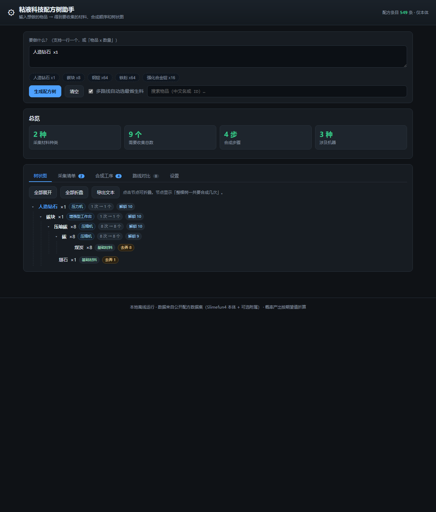

# 粘液科技配方树助手

**在线版（免安装）：<https://jonathansssst.github.io/slimefun-planner/>**



输入「想做的物品 + 数量」，输出**要去收集的材料清单**、**按顺序的合成工序**和**可折叠的树状图**。
纯前端运行，不联网、不上传任何数据。

> 适用：Minecraft 1.21.x + Fabric 客户端连的粘液科技服务器（Slimefun4 本体 + 常见附属）。
> 数据是公开配方数据集，**不需要**客户端装任何 mod，也不需要服务端配合。

---

## 三种用法

| 方式 | 适合谁 | 怎么用 |
|---|---|---|
| **在线版** | 任何人，免安装 | 打开 <https://jonathansssst.github.io/slimefun-planner/> |
| **本地网页版** | 想离线用、想改数据 | 双击 `启动配方助手.cmd`，浏览器打开 `http://127.0.0.1:8791/` |
| **命令行版** | 想批量算/接脚本 | `node tools\cli.mjs "人造钻石 x1"` |

两种网页版功能完全一样，区别只有一个：**手工补录的保存位置**。

- 在线版（GitHub Pages）没有后端，补录保存在**你自己的浏览器**（localStorage），不影响别人；
  可以用「导出 JSON / 导入 JSON」和队友交换补录，或者直接给仓库提 PR 改 `data/overrides.json`。
- 本地版会把补录写回 `data/overrides.json`，方便你自己维护一份公共补录。

---

### 基本用法

1. 在输入框写要做的东西，一行一个，支持 `物品 x 数量`：
   ```
   人造钻石 x2
   钢锭 128
   铁粉 ×64
   ```
2. 点「生成配方树」（或按 `Ctrl+Enter`）。也可以点下面的快捷标签，或用搜索框挑物品。
3. 看四个页签：
   - **树状图**：每个节点显示「整棵树一共要合成几次」和用什么机器；点击可折叠。
   - **采集清单**：到底要挖/要收多少，同一材料在多个分支共用时只算一次。
   - **合成工序**：先做什么后做什么，标注机器、批次和每次投料量。
   - **路线对比**：一个物品有多条合成途径时用的，默认自动选最省生料的那条，也可以手动切换。
4. 「设置」页里可以改基础材料名单、填自己的库存、手工补录配方。

### 命令行示例

```bat
node tools\cli.mjs "人造钻石 x1"
node tools\cli.mjs "强化合金锭 x16"
node tools\cli.mjs --list 钻石        :: 搜索物品
node tools\cli.mjs --json "钢锭 x10"  :: 输出 JSON，便于二次处理
node tools\cli.mjs --addons=匠魂工艺 "魂钢锭 x1"   :: 临时加载某个附属
```

---

## 它是怎么算的

### 1. 建图

配方数据里每条物品带一个「配方类型」和最多 9 格材料：

| 配方类型 | 处理方式 |
|---|---|
| 增强型工作台 / 魔法工作台 / 盔甲锻造台 / 古代祭坛 / 冶炼炉 / 洗矿机 / 压缩机 … | 可合成，需要机器 |
| 多方块结构 | 可合成，但需要搭结构 |
| 生物掉落 / 交易获得 / 自然资源开采机 / 空配方 | **采集终点**：直接进采集清单 |
| 没有配方条目 | 视为生料（多数是原版物品） |

### 2. 求解（关键部分）

不是「逐层递归展开」，而是**需求传播 + 逐级向上取整**的不动点迭代：

1. **需求**：一个物品的总需求 = 目标数量 + 所有父配方按当前合成次数要投的份数。
   共享中间产物（例如钢板和钢甲都要钢锭）只累加一次总量。
2. **取整**：`合成次数 = ceil(需求 / 一次产出)`。机器按整批执行，不能按小数算。
   例：铁粉一次产 2，需要 13 个 → 做 7 次共 14 个，多出的 1 个回流给别的分支。
3. **回代**：用新的合成次数重算需求，反复迭代到次数不再变化（真实数据上通常 3~18 轮）。

结果同时满足三件事：共享材料只算一次、每级按产出取整、余料先垫给其他分支。

### 3. 库存怎么处理

设置页填的库存（`铁锭 = 64`）**只抵扣"要去采集的数量"，不改变合成步骤**。
这样你看到的树、工序表和采购清单永远是一致的，不会因为库存而出现来回摇摆的数字。
树上会把「总需求 / 库存抵扣 / 还要弄到多少」分开显示。

### 4. 多路线择优

同一个物品有多条合成途径时，用固定点迭代算出每条路线的「单位生料成本」（做 1 个要消耗几份采集终点材料），
默认取最省的那条；「路线对比」页可以手动切换，切换后暂停自动择优。

### 5. 异常处理

- **循环配方**（A 要 B、B 要 A）：检出后按「需人工确认」列为材料，不会无限递归。
- **无配方数据的物品**：明确标注「无配方数据」，不静默当成生料。
- **概率产出**（如洗矿机出矿粉）：按期望值折算成需要的次数。

---

## 目录结构

```
slimefun-planner/
├─ 启动配方助手.cmd          # 双击启动（本地服务 + 自动开浏览器）
├─ index.html                # 单页应用外壳
├─ engine/                   # 与界面无关的纯逻辑（Node 与浏览器共用）
│  ├─ dataset.js             # JSONL → 配方索引、多路线、成本估算
│  ├─ solver.js              # 需求传播求解 + 供给分配
│  ├─ tree.js                # 树构建、采集清单、工序表
│  ├─ variants.js            # 多路线择优
│  ├─ data.js                # 数据装载 + 默认基础材料分组
│  └─ planner.js             # 统一入口 plan()
├─ ui/                       # 界面（原生 JS，无构建步骤）
├─ data/
│  ├─ recipes.core.jsonl     # 核心配方（Slimefun4 本体，549 条）
│  ├─ recipes.addons/*.jsonl # 附属配方（30 个，默认不加载）
│  ├─ overrides.json         # 你的手工补录，永久生效
│  └─ manifest.source.json   # 数据来源信息
├─ tools/
│  ├─ serve.mjs              # 本地服务（含 /api/overrides 保存接口）
│  ├─ cli.mjs                # 命令行版
│  ├─ analyze_dataset.py     # 数据集体检
│  └─ ui-probe.mjs           # 界面自检（最小 DOM 桩）
└─ tests/engine.test.mjs     # 引擎单元测试
```

---

## 数据来源与覆盖范围

- 核心 549 条配方来自公开数据集 [StarRingEngr/slimefunAsstOL](https://github.com/StarRingEngr/slimefunAsstOL)
  （Slimefun4 本体，含中文名、配方类型、产出数量、研究解锁等级）。
- 附属配方 30 个已放在 `data/recipes.addons/`，**默认不加载**（避免没玩的插件污染搜索）。
  要启用：把自己的附属文件名加进界面设置的本地配置，或命令行用 `--addons=名字`。
- 本机 `versions\DT-1.21.11-Fabric\mods` 里没有粘液科技相关 jar——粘液科技跑在服务器端，
  客户端读不到配方，所以用了公开数据集。服务端如果有魔改配方，用「手工补录」覆盖。

---

## 手工补录配方

数据里没有的物品（附属、魔改、活动物品）可以在「设置 → 手工补录配方」里补。

- **在线版**：点「保存到浏览器」存在你自己的浏览器里，可「导出 JSON」分享或备份，也可导入别人的补录。
- **本地版**：同样存在浏览器；想做成"所有人都能用"的公共补录，直接把下面这段 JSON 写进
  `data/overrides.json` 并提交即可（在线版会读取它，本地浏览器里的补录优先于它）。

```json
[
  {
    "id": "simefun4:MY_ITEM",
    "name": "我的物品",
    "recipeType": "增强型工作台",
    "output": 1,
    "materials": { "simefun4:STEEL_INGOT": 4, "IRON_INGOT": 2 }
  }
]
```

字段说明：

| 字段 | 说明 |
|---|---|
| `id` | 物品 ID。写已有 ID 表示**覆盖**它的配方；写新 ID 表示新增物品 |
| `name` | 中文名 |
| `recipeType` | 机器名。写「生物掉落」等采集类型就会当成采集终点 |
| `output` | 一次合成产出几个（默认 1） |
| `materials` | `{ 材料ID: 用几个 }`；也可以用 `recipe` 数组写 9 格槽位 |
| `appendVariant` | 设为 `true` 时作为**额外候选路线**保留，而不是覆盖 |
| `disable` | 设为 `true` 时忽略这个物品的配方 |

---

## 部署到自己的 GitHub Pages

仓库已经配好自动部署：推送到 `main` 就会跑单元测试并把静态站点发到 Pages。

```
在线地址：https://jonathansssst.github.io/slimefun-planner/
仓库地址：https://github.com/JonathanSssst/slimefun-planner
工作流：  .github/workflows/deploy-pages.yml（测试 → 组装 → 部署）
```

自己 fork 一份再发布：

1. fork 本仓库（或把整个 `slimefun-planner` 目录作为新仓库推上去）。
2. 仓库 **Settings → Pages → Source** 选 **GitHub Actions**。
3. 推送到 `main`，等 Actions 跑完，地址就是 `https://<你的用户名>.github.io/<仓库名>/`。

站点只用 `index.html`、`ui/`、`engine/`、`data/` 四个目录，全部是静态文件，任何静态托管
（Cloudflare Pages、Netlify、Vercel、自己服务器）丢上去就能用。

---

## 更新线上内容

| 想改什么 | 怎么做 |
|---|---|
| 补一条配方（所有人可见） | 改 `data/overrides.json` → 提交 → Actions 自动重新部署 |
| 加一个附属插件的数据 | 把 `.jsonl` 放进 `data/recipes.addons/` → 提交 |
| 改算法/界面 | 改 `engine/` 或 `ui/` → 提交；工作流会先跑单测再部署 |
| 只自己用、不想动仓库 | 在页面「设置」里补录并保存到浏览器，或导出/导入 JSON |

---

## 已知限制（用之前请知道）

1. **数据集每件物品只记录一条配方**。例如铁粉记的是「矿石粉碎机：铁矿石 → 铁粉×2」，
   而实际上还能用洗矿机（筛矿）、电力打粉机（锭）得到。
   - 处理办法：把「铁粉」从基础材料名单里去掉，它会按数据集里那条路线展开；
     其它途径用「手工补录 + 多路线」补上。
2. **原版工作台配方基本不在数据集里**（例如 9 个锭 ↔ 1 个块）。
   这些物品会显示成「基础材料」。
3. **附属插件是否开启、服务端是否魔改**：数据来自公开数据集，和你的服务器可能有差异。
   研究解锁等级（`解锁 N`）只是提示，实际能不能做要在游戏里确认。
4. **概率产出按期望值折算**，实际收集量会有波动。
5. 客户端 mods 里没有粘液科技，所以**不能**直接从你正在玩的服务器读取配方。

---

## 自检与测试

```bat
node --test tests/engine.test.mjs tests/overrides.test.mjs   :: 单元测试（13 项）
node tools/ui-probe.mjs http://127.0.0.1:8791                 :: 界面自检（需先启动服务）
node tools/ui-probe.mjs https://jonathansssst.github.io/slimefun-planner/   :: 线上站点自检
python tools/analyze_dataset.py data/recipes.core.jsonl       :: 数据集体检
```

单元测试覆盖：按格计数、一次产出多件向上取整、共享中间产物合并、基础材料截断展开、
库存抵扣采购清单、循环依赖检出、多路线择优、采集型条目不展开、无配方数据标记，
以及补录的覆盖/新增/设为采集终点、数据集完整性。

界面自检用一个最小 DOM 桩把 `ui/app.js` 完整跑一遍，验证「数据加载 → 计算 → 四个页签渲染」
全程无异常；线上站点可以用同一个命令验证，例如线上返回：

```
✔ 无未捕获异常   ✔ 树状图已渲染节点   ✔ 采集清单已渲染   ✔ 合成工序已渲染
树状图首节点：人造钻石 ×1（压力机 1 次 → 1 个，解锁 10）→ 碳块 ×1 → 压缩碳 ×8 → 碳 ×8 → 煤炭 ×8
```

单元测试覆盖：按格计数、一次产出多件向上取整、共享中间产物合并、基础材料截断展开、
库存抵扣采购清单、循环依赖检出、多路线择优、采集型条目不展开、无配方数据标记。
