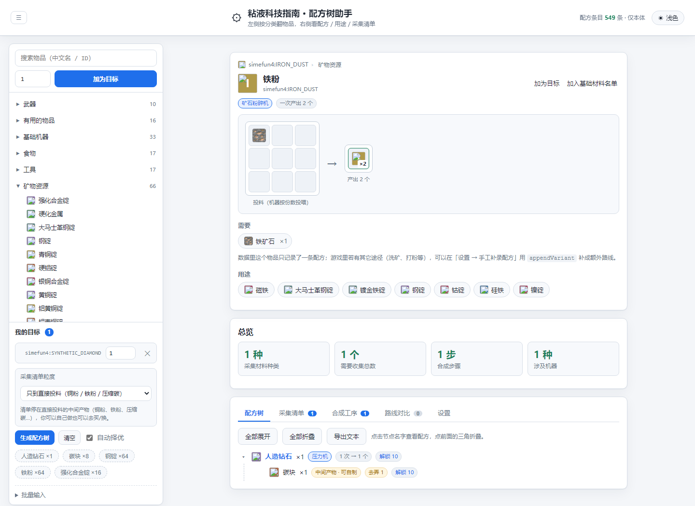
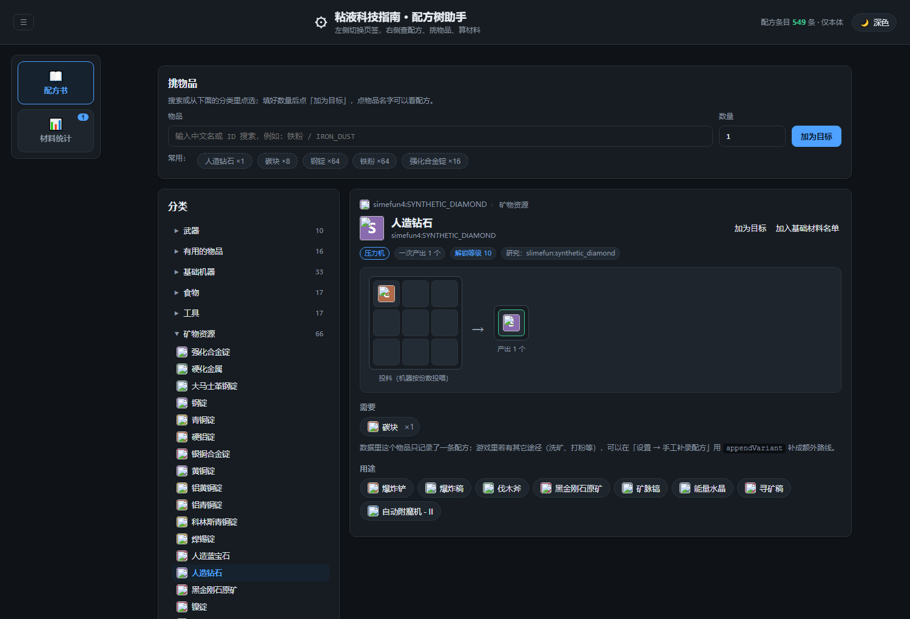
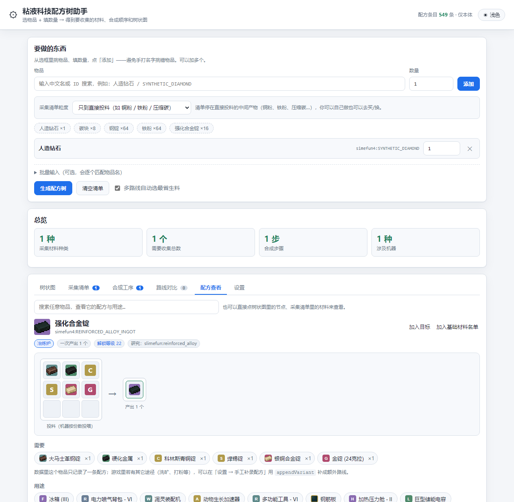

# 粘液科技配方树助手

**在线版（免安装）：<https://jonathansssst.github.io/slimefun-planner/>**



<details>
<summary>深色主题（点右上角按钮切换，也可用 <code>?theme=dark</code> 直接打开）</summary>



</details>

输入「想做的物品 + 数量」，输出**要去收集的材料清单**、**按顺序的合成工序**和**可折叠的树状图**；
同时它也是一本**网页版粘液科技指南书**：按分类翻物品、查任意物品的配方与用途、点材料跳转。

纯前端运行，不联网也能用（图标除外）。默认浅色主题，右上角一键切深色，选择会被记住。

> 适用：Minecraft 1.21.x + Fabric 客户端连的粘液科技服务器（Slimefun4 本体 + 常见附属）。
> 数据是公开配方数据集，**不需要**客户端装任何 mod，也不需要服务端配合。

---

## 三种用法

| 方式 | 适合谁 | 怎么用 |
|---|---|---|
| **在线版** | 任何人，免安装 | 打开 <https://jonathansssst.github.io/slimefun-planner/> |
| **本地网页版** | 想离线用、想改数据 | 双击 `启动配方助手.cmd`，浏览器打开 `http://127.0.0.1:8791/` |
| **命令行版** | 想批量算/接脚本 | `node tools\cli.mjs "人造钻石 x1"` |

两种网页版功能完全一样，区别只有一个：**手工补录的保存位置**。

- 在线版（GitHub Pages）没有后端，补录保存在**你自己的浏览器**（localStorage），不影响别人；
  可以用「导出 JSON / 导入 JSON」和队友交换补录，或者直接给仓库提 PR 改 `data/overrides.json`。
- 本地版会把补录写回 `data/overrides.json`，方便你自己维护一份公共补录。

---

### 物品图标 + 配方查看

- **图标来源（优先级从高到低）**：
  1. 你自己登记的覆盖（[data/icons.json](slimefun-planner/data/icons.json) 的 `overrides`）；
  2. **本机资源包抽取的本地缓存**（推荐：最准、离线可用。见下面「用本机资源包做图标」）；
  3. 粘液科技物品的公开镜像映射（[data/icon-map.json](slimefun-planner/data/icon-map.json)，119 条）；
  4. 原版物品的公开镜像 [`misode/mcmeta`](https://github.com/misode/mcmeta)（item 优先，block 兜底）；
  5. 都没有时显示按 ID 生成的彩色首字母徽章。
- 仓库**不打包任何游戏素材**：只存"物品 ID → 地址"的映射；本地抽取出来的 PNG 在 `.gitignore` 里，不会提交。
- 「设置 → 显示」里可以一键关掉图标（关掉后不请求任何外部图片）。

#### 用本机资源包做图标（推荐，一步到位）

粘液科技插件本体**不带贴图**（贴图在资源包/服务端材质包里），所以想拿真实图标，最快的办法是从
**你自己已安装的粘液科技材质包**里抽：

```bat
node tools\extract-pack-icons.mjs            :: 主用：以资源包的模型文件为准抽取（推荐）
node --use-system-ca tools\fetch-head-icons.mjs   :: 可选：给"玩家头颅"类物品补脸部图标
```

实测（1.21.11 粘液科技材质包）：**527 个物品由资源包模型文件确定 + 5 个人工别名 = 532/549 = 96.9%**，
抽出的图共约 180 KB，放在 `data/icons/`，浏览器直接加载，完全离线。
每个图标的来源都记录在 `data/icons/icon-provenance.json` 里，可以追溯（`model:…` / `head:…` / `alias:…`）。

**为什么以"模型文件"为准**：资源包里每个自定义物品都有一个模型文件，
`assets/<命名空间>/models/<路径>.json`，它的路径（去掉 `models/`）就是贴图路径
`assets/<命名空间>/textures/<路径>.png`——这是作者自己的对应关系。
（模型 json 内部被作者混淆过：键名带零宽字符、内容用 `\uXXXX` 转义，所以只取路径、不解析内部键。）
旧版脚本纯按物品 ID 猜文件名，会把别的附属插件的同名贴图抓错（例如 `SOLAR_PANEL` 抓到
`infinityexpansion2` 的贴图），现在改成了模型优先。

**头颅类物品**（导能水晶、碳、护身符…在游戏里是玩家头颅，贴图以皮肤哈希写在插件 `HeadTexture.java` 里）
可以取皮肤后裁出脸部做图标：

```bat
node --use-system-ca tools/extract-head-textures.mjs   :: 抽取插件里的皮肤哈希表
node --use-system-ca tools/fetch-head-icons.mjs        :: 取皮肤 → 裁脸 → 16×16 图标
```

**验证过的事**（不是猜的）：

- 资源包里有模型文件的 478 个物品，我们抽出的 PNG 与模型推导出的贴图**逐字节一致**（0 处不一致）；
- 校对工具：`node tools/verify-icon-models.mjs`（模型 vs 抽取结果比对）、
  `node tools/audit-icons.mjs`（找出跨命名空间/别名等可疑匹配）、
  `node tools/make-icon-sheet.mjs`（拼成带分类分块的大图，方便人眼核对）。

**仍然缺图标的 17 个**：大马士革钢/强化合金/锁链的盔甲四件套、潜水头盔、防化靴、农夫的靴子、
不死图腾、合成机智能交互接口。原因：这套材质包**没有**给它们平面贴图（盔甲用的是 OptiFine
图层纹理 `layer_1.png`，只能给整个模型上色，没法当独立物品图标）。它们会回退到原版图标/首字母徽章，
你可以在「设置 → 手工补录」里用 `data/icons.json` 的 `overrides` 自己指定。

#### 配方查看

新增「配方查看」页签。可以搜索任意物品，也可以直接**点树状图节点 / 采集清单里的材料**打开，看到：

- 投料网格（增强型工作台/魔法工作台等按 3×3 摆位显示；冶炼炉/洗矿机等按"投料份数"显示）
- 产出数量、所属机器、研究解锁等级
- 每种材料的图标与数量（点材料可以继续往下看）
- **用途**：哪些物品会用到它（反过来查"这东西能做啥"）
- 多路线提示：数据集只有一条配方时，会提示可以用补录加 `appendVariant` 补充其它途径

深链接：`…/slimefun-planner/#recipe=simefun4:IRON_DUST` 可直接打开某个物品的配方，方便分享。



### 采集清单粒度（重点）

「采集清单」默认**停在直接投料的中间产物**，不一路打到煤炭、沙砾：

| 粒度 | 目标：强化合金锭 ×16 的采集清单 |
|---|---|
| **只到直接投料**（默认） | 大马士革钢锭×16、硬化金属×16、科林斯青铜锭×16、焊锡锭×16、银铜合金锭×16、金锭(24克拉)×16 |
| 再展开一层 | 再往下拆一层（钢锭、压缩碳、各种粉…） |
| 全部展开到生料 | 筛矿×304、金矿石×96、煤炭×80、铁锭×64、铁矿石×32 |

在输入区上方的「采集清单粒度」下拉里切换，选择会记住。清单里这类停在断层的中间产物会标成
**「中间产物 · 可自制」**——意思是"你可以照清单去凑，也可以自己做"，需要细节时把粒度调深即可。

命令行同样支持：

```bat
node tools\cli.mjs "强化合金锭 x16"              :: 默认一层
node tools\cli.mjs --depth=2 "强化合金锭 x16"    :: 再深一层
node tools\cli.mjs --depth=all "强化合金锭 x16"  :: 展开到生料
```

> 另外，「设置 → 基础材料名单」是另一种控制方式：勾掉的物品无论如何都直接进清单。
> 两种方式可以叠加使用。

### 基本用法

1. **从选框里挑物品**：在上面搜索框输入中文名或 ID（例如 `人造钻石` / `SYNTHETIC_DIAMOND`），
   从下拉列表里点选，填好数量点「添加」。这样不会因为手打名字而抓错物品。
2. 可以加多个目标，清单里每一项都能随时改数量或删掉；下面还有几个常用快捷标签。
3. 点「生成配方树」。看四个页签：
   - **树状图**：每个节点显示「整棵树一共要合成几次」和用什么机器；点击可折叠。
     到达采集粒度断层的节点会显示成叶子并标「中间产物 · 可自制」。
   - **采集清单**：到底要挖/要收多少，同一材料在多个分支共用时只算一次。
   - **合成工序**：先做什么后做什么，标注机器、批次和每次投料量。
   - **路线对比**：一个物品有多条合成途径时用的，默认自动选最省生料的那条，也可以手动切换。
4. 「设置」页里可以改基础材料名单、填自己的库存、手工补录配方。
5. 右上角按钮切换**浅色 / 深色**主题（默认浅色，选择会记住）；想直接分享深色版链接就在网址后面加 `?theme=dark`。

> 如果你更习惯打字，展开「批量输入」框粘贴多行文本（`物品名 x 数量`）。
> 名称匹配不上的会明确列出来提示，**不会**静默抓成别的物品。

### 命令行示例

```bat
node tools\cli.mjs "人造钻石 x1"
node tools\cli.mjs "强化合金锭 x16"
node tools\cli.mjs --list 钻石        :: 搜索物品
node tools\cli.mjs --json "钢锭 x10"  :: 输出 JSON，便于二次处理
node tools\cli.mjs --addons=匠魂工艺 "魂钢锭 x1"   :: 临时加载某个附属
```

---

## 它是怎么算的

### 1. 建图

配方数据里每条物品带一个「配方类型」和最多 9 格材料：

| 配方类型 | 处理方式 |
|---|---|
| 增强型工作台 / 魔法工作台 / 盔甲锻造台 / 古代祭坛 / 冶炼炉 / 洗矿机 / 压缩机 … | 可合成，需要机器 |
| 多方块结构 | 可合成，但需要搭结构 |
| 生物掉落 / 交易获得 / 自然资源开采机 / 空配方 | **采集终点**：直接进采集清单 |
| 没有配方条目 | 视为生料（多数是原版物品） |

### 2. 求解（关键部分）

不是「逐层递归展开」，而是**需求传播 + 逐级向上取整**的不动点迭代：

1. **需求**：一个物品的总需求 = 目标数量 + 所有父配方按当前合成次数要投的份数。
   共享中间产物（例如钢板和钢甲都要钢锭）只累加一次总量。
2. **取整**：`合成次数 = ceil(需求 / 一次产出)`。机器按整批执行，不能按小数算。
   例：铁粉一次产 2，需要 13 个 → 做 7 次共 14 个，多出的 1 个回流给别的分支。
3. **回代**：用新的合成次数重算需求，反复迭代到次数不再变化（真实数据上通常 3~18 轮）。

结果同时满足三件事：共享材料只算一次、每级按产出取整、余料先垫给其他分支。

### 3. 库存怎么处理

设置页填的库存（`铁锭 = 64`）**只抵扣"要去采集的数量"，不改变合成步骤**。
这样你看到的树、工序表和采购清单永远是一致的，不会因为库存而出现来回摇摆的数字。
树上会把「总需求 / 库存抵扣 / 还要弄到多少」分开显示。

### 4. 多路线择优

同一个物品有多条合成途径时，用固定点迭代算出每条路线的「单位生料成本」（做 1 个要消耗几份采集终点材料），
默认取最省的那条；「路线对比」页可以手动切换，切换后暂停自动择优。

### 5. 异常处理

- **循环配方**（A 要 B、B 要 A）：检出后按「需人工确认」列为材料，不会无限递归。
- **无配方数据的物品**：明确标注「无配方数据」，不静默当成生料。
- **概率产出**（如洗矿机出矿粉）：按期望值折算成需要的次数。

---

## 目录结构

```
slimefun-planner/
├─ 启动配方助手.cmd          # 双击启动（本地服务 + 自动开浏览器）
├─ index.html                # 单页应用外壳
├─ engine/                   # 与界面无关的纯逻辑（Node 与浏览器共用）
│  ├─ dataset.js             # JSONL → 配方索引、多路线、成本估算
│  ├─ solver.js              # 需求传播求解 + 供给分配
│  ├─ tree.js                # 树构建、采集清单、工序表
│  ├─ variants.js            # 多路线择优
│  ├─ data.js                # 数据装载 + 默认基础材料分组
│  └─ planner.js             # 统一入口 plan()
├─ ui/                       # 界面（原生 JS，无构建步骤）
├─ data/
│  ├─ recipes.core.jsonl     # 核心配方（Slimefun4 本体，549 条）
│  ├─ recipes.addons/*.jsonl # 附属配方（30 个，默认不加载）
│  ├─ overrides.json         # 你的手工补录，永久生效
│  └─ manifest.source.json   # 数据来源信息
├─ tools/
│  ├─ serve.mjs              # 本地服务（含 /api/overrides 保存接口）
│  ├─ cli.mjs                # 命令行版
│  ├─ analyze_dataset.py     # 数据集体检
│  └─ ui-probe.mjs           # 界面自检（最小 DOM 桩）
└─ tests/engine.test.mjs     # 引擎单元测试
```

---

## 数据来源与覆盖范围

- 核心 549 条配方来自公开数据集 [StarRingEngr/slimefunAsstOL](https://github.com/StarRingEngr/slimefunAsstOL)
  （Slimefun4 本体，含中文名、配方类型、产出数量、研究解锁等级）。
- 附属配方 30 个已放在 `data/recipes.addons/`，**默认不加载**（避免没玩的插件污染搜索）。
  要启用：把自己的附属文件名加进界面设置的本地配置，或命令行用 `--addons=名字`。
- 本机 `versions\DT-1.21.11-Fabric\mods` 里没有粘液科技相关 jar——粘液科技跑在服务器端，
  客户端读不到配方，所以用了公开数据集。服务端如果有魔改配方，用「手工补录」覆盖。

---

## 手工补录配方

数据里没有的物品（附属、魔改、活动物品）可以在「设置 → 手工补录配方」里补。

- **在线版**：点「保存到浏览器」存在你自己的浏览器里，可「导出 JSON」分享或备份，也可导入别人的补录。
- **本地版**：同样存在浏览器；想做成"所有人都能用"的公共补录，直接把下面这段 JSON 写进
  `data/overrides.json` 并提交即可（在线版会读取它，本地浏览器里的补录优先于它）。

```json
[
  {
    "id": "simefun4:MY_ITEM",
    "name": "我的物品",
    "recipeType": "增强型工作台",
    "output": 1,
    "materials": { "simefun4:STEEL_INGOT": 4, "IRON_INGOT": 2 }
  }
]
```

字段说明：

| 字段 | 说明 |
|---|---|
| `id` | 物品 ID。写已有 ID 表示**覆盖**它的配方；写新 ID 表示新增物品 |
| `name` | 中文名 |
| `recipeType` | 机器名。写「生物掉落」等采集类型就会当成采集终点 |
| `output` | 一次合成产出几个（默认 1） |
| `materials` | `{ 材料ID: 用几个 }`；也可以用 `recipe` 数组写 9 格槽位 |
| `appendVariant` | 设为 `true` 时作为**额外候选路线**保留，而不是覆盖 |
| `disable` | 设为 `true` 时忽略这个物品的配方 |

---

## 部署到自己的 GitHub Pages

仓库已经配好自动部署：推送到 `main` 就会跑单元测试并把静态站点发到 Pages。

```
在线地址：https://jonathansssst.github.io/slimefun-planner/
仓库地址：https://github.com/JonathanSssst/slimefun-planner
工作流：  .github/workflows/deploy-pages.yml（测试 → 组装 → 部署）
```

仓库的 About 描述、主页链接和 topics 用脚本同步（中文务必走这个脚本，
PowerShell 5.1 直接发 JSON 会因本地编码在 GitHub 上显示成乱码）：

```bat
node --use-system-ca tools\set-repo-meta.mjs
```

自己 fork 一份再发布：

1. fork 本仓库（或把整个 `slimefun-planner` 目录作为新仓库推上去）。
2. 仓库 **Settings → Pages → Source** 选 **GitHub Actions**。
3. 推送到 `main`，等 Actions 跑完，地址就是 `https://<你的用户名>.github.io/<仓库名>/`。

站点只用 `index.html`、`ui/`、`engine/`、`data/` 四个目录，全部是静态文件，任何静态托管
（Cloudflare Pages、Netlify、Vercel、自己服务器）丢上去就能用。

---

## 更新线上内容

| 想改什么 | 怎么做 |
|---|---|
| 补一条配方（所有人可见） | 改 `data/overrides.json` → 提交 → Actions 自动重新部署 |
| 加一个附属插件的数据 | 把 `.jsonl` 放进 `data/recipes.addons/` → 提交 |
| 改算法/界面 | 改 `engine/` 或 `ui/` → 提交；工作流会先跑单测再部署 |
| 只自己用、不想动仓库 | 在页面「设置」里补录并保存到浏览器，或导出/导入 JSON |

---

## 界面：侧边栏指南书 + 配方树

整体做成了**游戏内指南书（`/sf guide`）的网页版**：

```
┌───────────────┬──────────────────────────────────────┐
│ 搜索物品       │  面包屑：ID › 资源 › 黑金刚石          │
│ 数量 [1] 加为目标│  物品名 + 大图标 + 加为目标 / 加为基础材料│
│               │  机器 · 产出 · 解锁等级 · 研究项        │
│ ▸ 武器     13 │  投料网格  →  产出                     │
│ ▸ 基础机器  46 │  需要：材料（可点开继续查）             │
│ ▾ 资源    102 │  用途：哪些物品用到它（可点开）          │
│   ▸ 锭     26 │                                       │
│   ▸ 矿粉   16 │  ── 总览 ──                            │
│ ▸ 防具     60 │  ── 配方树 / 采集清单 / 合成工序 / 路线对比 ──│
│ 我的目标  1   │                                       │
│  采集清单粒度  │                                       │
│  生成配方树    │                                       │
└───────────────┴──────────────────────────────────────┘
```

- **侧边栏**：分类树（分类 → 子分类 → 物品，共 20 个分类，549 个物品全部归类）、
  按名字/ID 实时过滤、每个物品后面有「+」直接加为目标、自己可收起（状态会记住）。
- **主区**：点分类里的物品 → 显示配方与用途；面包屑显示所属分类并可点击跳回；
  左上角有「←」返回上一个看过的物品（浏览历史）。
- **配方树**仍在下方：目标 → 采集清单 / 合成工序 / 配方树，与指南书浏览互不干扰。
- 深链接：`#recipe=simefun4:IRON_DUST` 直接打开某个物品的配方。

### 分类数据：从插件源码导出（权威）

分类**不是猜的**。`data/category-sources.json` 是从 Slimefun4 源码导出的权威映射：

- 每个物品的分类来自 `implementation/setup/SlimefunItemSetup.java` 里**真实的 `register(...)` 调用**
  （分类键取自 `DefaultItemGroups.java`，就是游戏内指南书的分组），**547/549 = 99.6% 有源码依据**；
- 分类共 24 个，与指南书一致：`resources`（矿物资源）66、`electricity`（能源与电力）77、
  `misc` 42、`basic_machines` 33、`magical_gadgets` 30、`armor` 28、`technical_gadgets` 28、
  `magical_armor` 27、`magical_items` 26、`tech_misc` 20、`christmas` 19、`food` 17、`gps` 17、
  `tools` 16、`items` 16、`talismans` 16、`ender_talismans` 16、`androids` 15、`cargo` 12、
  `weapons` 10、`valentines_day` 6、`halloween` 6、`easter` 3、`birthday` 1；
- 未覆盖的 2 个：`HERCULES_PICKAXE`（只在研究成果/ wiki 名称里出现，没有注册调用）、
  `CRAFTER_SMART_PORT`（整个仓库里都找不到），它们按规则兜底归类。

生成流程：

```bat
:: 1) 抓中文 wiki 分类页（可选，用于补分类名与来源交叉验证）
node --use-system-ca tools/fetch-wiki-categories.mjs
:: 2) 把源码导出的原始表压成入库的精简版 data/category-sources.json
node tools/pack-category-sources.mjs
:: 3) 合并生成 data/categories.json
node tools/build-categories.mjs
```

> 原始导出（含每条证据的源码行号）依赖外部调研产物，不入库；入库的是精简映射表
> `data/category-sources.json`（37 KB），所以第 3 步在任何环境都能跑。
> 想自己重新导出，可参考 `research/HeadTexture.java` 与 `tools/extract-head-textures.mjs` 的做法。

## 已知限制（用之前请知道）

1. **数据集每件物品只记录一条配方**。例如铁粉记的是「矿石粉碎机：铁矿石 → 铁粉×2」，
   而实际上还能用洗矿机（筛矿）、电力打粉机（锭）得到。
   - 处理办法：把「铁粉」从基础材料名单里去掉，它会按数据集里那条路线展开；
     其它途径用「手工补录 + 多路线」补上。
2. **原版工作台配方基本不在数据集里**（例如 9 个锭 ↔ 1 个块）。
   这些物品会显示成「基础材料」。
3. **附属插件是否开启、服务端是否魔改**：数据来自公开数据集，和你的服务器可能有差异。
   研究解锁等级（`解锁 N`）只是提示，实际能不能做要在游戏里确认。
4. **概率产出按期望值折算**，实际收集量会有波动。
5. 客户端 mods 里没有粘液科技，所以**不能**直接从你正在玩的服务器读取配方。

---

## 自检与测试

```bat
node --test tests/engine.test.mjs tests/overrides.test.mjs tests/depth.test.mjs tests/recipe-view.test.mjs   :: 单元测试（34 项）
node tools/ui-probe.mjs http://127.0.0.1:8791                 :: 界面自检（需先启动服务）
node tools/ui-probe.mjs "http://127.0.0.1:8791/?theme=dark"   :: 顺带验证深色主题
node tools/ui-probe.mjs https://jonathansssst.github.io/slimefun-planner/   :: 线上站点自检
python tools/analyze_dataset.py data/recipes.core.jsonl       :: 数据集体检
node tools/extract-local-icons.mjs                            :: 从本机材质包抽图标（推荐）
node --use-system-ca tools/build-icon-map.mjs                 :: 重新生成在线图标映射
node --use-system-ca tools/download-icons.mjs                 :: 没装材质包时的备选：从公开镜像下载
```

图标相关的其它工具：
`tools/extract-head-textures.mjs`（抽取插件里的 HeadTexture 皮肤哈希，用于核对覆盖率）、
`tools/suggest-icon-aliases.mjs`（分析资源包里命名对不上的贴图，给别名表提建议）。

> 顺便说一句：Slimefun 插件 jar 里**没有贴图**（我下载了汉化版 2026.1 构建 6.8MB 核对过，
> 里面只有代码和语言文件，`HeadTexture.java` 里存的是皮肤哈希）；贴图在资源包里。
> 皮肤服务（mc-heads / Crafatar / mineatar）都不接受"原始贴图哈希"，所以头颅类物品的图标
> 走的是本机资源包抽取或原版镜像兜底。


单元测试覆盖：按格计数、一次产出多件向上取整、共享中间产物合并、基础材料截断展开、
库存抵扣采购清单、循环依赖检出、多路线择优、采集型条目不展开、无配方数据标记，
以及补录的覆盖/新增/设为采集终点、数据集完整性。

界面自检用一个最小 DOM 桩把 `ui/app.js` 完整跑一遍，验证「数据加载 → 计算 → 四个页签渲染」
全程无异常；线上站点可以用同一个命令验证，例如线上返回：

```
✔ 无未捕获异常   ✔ 树状图已渲染节点   ✔ 采集清单已渲染   ✔ 合成工序已渲染
树状图首节点：人造钻石 ×1（压力机 1 次 → 1 个，解锁 10）→ 碳块 ×1 → 压缩碳 ×8 → 碳 ×8 → 煤炭 ×8
```

单元测试覆盖：按格计数、一次产出多件向上取整、共享中间产物合并、基础材料截断展开、
库存抵扣采购清单、循环依赖检出、多路线择优、采集型条目不展开、无配方数据标记。
